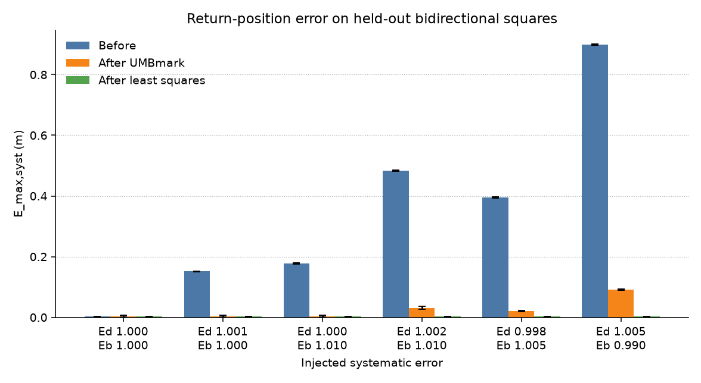
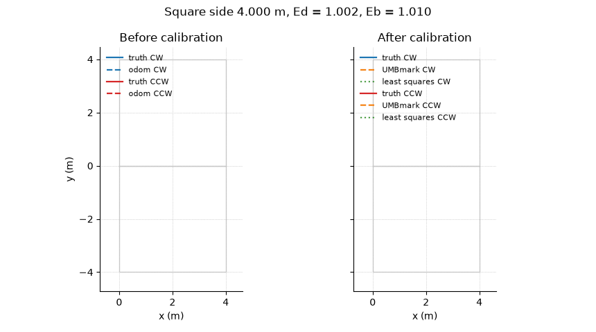

# odomcal

[](https://github.com/a-haz/odomcal/actions/workflows/ci.yml)

odomcal measures and corrects the two dominant systematic odometry errors of a differential-drive robot: unequal wheel diameters and an incorrect track width. A seedable unicycle simulator executes the bidirectional square of the UMBmark procedure, the closed-form solution of Borenstein and Feng recovers the diameter ratio and the baseline ratio, and a linear least-squares fit recovers the left wheel radius, the right wheel radius, and the track width from the same logged runs. Held-out squares then report the systematic return-position error and the heading error before and after each correction.

## Method

The plant is a differential-drive unicycle. Wheel rotations `dphi_L` and `dphi_R` (radians) produce a body displacement and a yaw increment

```
ds    = (r_R * dphi_R + r_L * dphi_L) / 2
dth   = (r_R * dphi_R - r_L * dphi_L) / b
```

which are integrated as a circular arc. The two systematic parameters follow Borenstein and Feng. `Ed = r_R / r_L` is the wheel-diameter ratio and `Eb = b_actual / b_nominal` is the track-width ratio. Injected errors keep the arithmetic mean of the two radii at the nominal radius, so a pure diameter mismatch is not also a scale error. Zero-mean Gaussian slip is added to the executed wheel rotations and is not seen by the encoders.

UMBmark drives a square of side `L` in both directions, stops after each leg, and turns in place through a nominal right angle, including the fourth turn that restores the initial heading. At least five runs are taken clockwise and five counter-clockwise. The return-position error on a run is the ground-truth pose minus the odometry pose. The centers of gravity of those errors are

```
x_cg,cw  = (1/n) sum_i x_i,cw      y_cg,cw  = (1/n) sum_i y_i,cw
x_cg,ccw = (1/n) sum_i x_i,ccw     y_cg,ccw = (1/n) sum_i y_i,ccw
r_cg     = sqrt(x_cg^2 + y_cg^2)
E_max,syst = max(r_cg,cw, r_cg,ccw)
```

Type A (baseline) and Type B (diameter) orientation errors, in radians, are separated on the longitudinal centers of gravity:

```
alpha = (x_cg,cw + x_cg,ccw) / (-4 L)
beta  = (x_cg,cw - x_cg,ccw) / (-4 L)
```

The track-width ratio and the diameter ratio then follow from the square geometry:

```
Eb = 90 deg / (90 deg - alpha_deg)
R  = (L / 2) / sin(beta / 2)
Ed = (R + b/2) / (R - b/2)
```

The odometry correction leaves the average wheel diameter unchanged:

```
c_L = 2 / (Ed + 1)
c_R = 2 / ((1/Ed) + 1)
r_L = c_L * r_nominal
r_R = c_R * r_nominal
b   = Eb * b_nominal
```

The least-squares estimator uses the same encoder logs and the externally measured pose at every integration step. Arc length `ds` is reconstructed from the chord of the step, and each step contributes the linear pair

```
 r_L * dphi_L + r_R * dphi_R         = 2 ds
-r_L * dphi_L + r_R * dphi_R - b dth = 0
```

The stacked system is solved by a rank-revealing QR factorization. `Ed` and `Eb` are then `r_R / r_L` and `b / b_nominal`. Calibration runs and the runs that are scored are drawn from different seeds, so the reported before/after errors are held out from the fit. Corrected odometry is replayed on the held-out encoder logs; the plant is unchanged.

Every number in the results below is copied from `docs/benchmark.csv`, which `odomcal_bench` writes. Geometry for that file: square side `4.00000000` m, nominal wheel radius `0.05000000` m, nominal track width `0.30000000` m, `5` runs in each direction, `8` seeds, wheel-slip standard deviation `0.00050000` rad per step, and `16` steps on each straight leg and each turn.

## Results

All results are from simulation, not from a physical robot. The systematic errors `Ed` and `Eb` in each row are injected into the simulated plant, so the true values are known and recovery can be checked directly. Real hardware adds effects (floor contact, non-constant slip, encoder quantization) that this simulator does not model.

Mean over the `8` seeds (`row_type=mean`). Return error is `E_max,syst` in metres. Heading error is the mean absolute yaw of the return-position error, in degrees.

| Ed | Eb | E_max before | heading before | E_max UMBmark | heading UMBmark | E_max least squares | heading least squares |
| --- | --- | --- | --- | --- | --- | --- | --- |
| 1.00000000 | 1.00000000 | 0.00221049 | 0.06153584 | 0.00395952 | 0.07571997 | 0.00238390 | 0.06379108 |
| 1.00100000 | 1.00000000 | 0.15190557 | 3.05354391 | 0.00410838 | 0.08330204 | 0.00238096 | 0.06379299 |
| 1.00000000 | 1.01000000 | 0.17760878 | 3.55548231 | 0.00396776 | 0.08086354 | 0.00239221 | 0.06315948 |
| 1.00200000 | 1.01000000 | 0.48345050 | 6.04429644 | 0.03153240 | 0.33588174 | 0.00238652 | 0.06316326 |
| 0.99800000 | 1.00500000 | 0.39455269 | 6.08792844 | 0.02077996 | 0.26656089 | 0.00239442 | 0.06346990 |
| 1.00500000 | 0.99000000 | 0.89934299 | 15.39400443 | 0.09115732 | 1.45105474 | 0.00236227 | 0.06444504 |

Recovered ratios on the same mean rows, next to the injected values:

| Ed true | Eb true | Ed UMBmark | Eb UMBmark | Ed least squares | Eb least squares |
| --- | --- | --- | --- | --- | --- |
| 1.00000000 | 1.00000000 | 1.00000013 | 1.00001064 | 0.99999951 | 0.99999144 |
| 1.00100000 | 1.00000000 | 1.00099973 | 0.99984071 | 1.00099950 | 0.99999144 |
| 1.00000000 | 1.01000000 | 1.00000012 | 1.00985012 | 0.99999951 | 1.00999136 |
| 1.00200000 | 1.01000000 | 1.00189538 | 1.00911159 | 1.00199949 | 1.00999136 |
| 0.99800000 | 1.00500000 | 0.99805417 | 1.00426024 | 0.99799953 | 1.00499140 |
| 1.00500000 | 0.99000000 | 1.00516543 | 0.98604066 | 1.00499947 | 0.98999153 |

On the level `Ed = 1.00200000`, `Eb = 1.01000000`, the mean return error is `0.48345050` m before correction, `0.03153240` m after UMBmark, and `0.00238652` m after least squares. The mean heading error on that level is `6.04429644` deg before correction, `0.33588174` deg after UMBmark, and `0.06316326` deg after least squares. The least-squares radii and track width on that mean row are `r_L = 0.04994999` m, `r_R = 0.05004987` m, and `b = 0.30299741` m, against the plant values `0.04995005` m, `0.05004995` m, and `0.30300000` m.

With no injected systematic error (`Ed = 1.00000000`, `Eb = 1.00000000`), the mean return error is `0.00221049` m before correction, `0.00395952` m after UMBmark, and `0.00238390` m after least squares. Both corrections remain at the slip floor, and the closed-form fit does not reduce a cloud that has no systematic offset.



The animation is the first held-out clockwise square and the first held-out counter-clockwise square for seed `0` at `Ed = 1.00200000`, `Eb = 1.01000000` (`docs/trajectories.csv`). Solid lines are ground truth. Dashed lines are odometry. Before calibration, odometry traces the commanded square while the plant drifts. After calibration, the least-squares odometry lies on the ground truth; the UMBmark odometry follows it with the residual of the square-path approximation.



## Build and run

The library is C++17. CMake fetches Eigen 3.4.0 and GoogleTest 1.15.2. The plot script needs Python 3 with `matplotlib` and `pillow`.

```bash
cmake -S . -B build -DCMAKE_BUILD_TYPE=Release -DCMAKE_CXX_COMPILER=g++
cmake --build build -j
ctest --test-dir build --output-on-failure
./build/odomcal_bench docs/benchmark.csv docs/trajectories.csv
python3 scripts/plot_benchmark.py
```

`odomcal_bench` rewrites the CSV files above. The plot script reads them and writes `docs/emax_before_after.png` and `docs/trajectories.gif`.

A ROS 2 node that applies these corrections to wheel-tick odometry is left as future work.

## References

Borenstein, J. and Feng, L. (1996). Measurement and Correction of Systematic Odometry Errors in Mobile Robots. IEEE Transactions on Robotics and Automation, 12(6), 869–880.

Borenstein, J. and Feng, L. (1995). UMBmark: A Benchmark Test for Measuring Odometry Errors in Mobile Robots. Proceedings of the SPIE Conference on Mobile Robots, Philadelphia, 22–26 October 1995.
